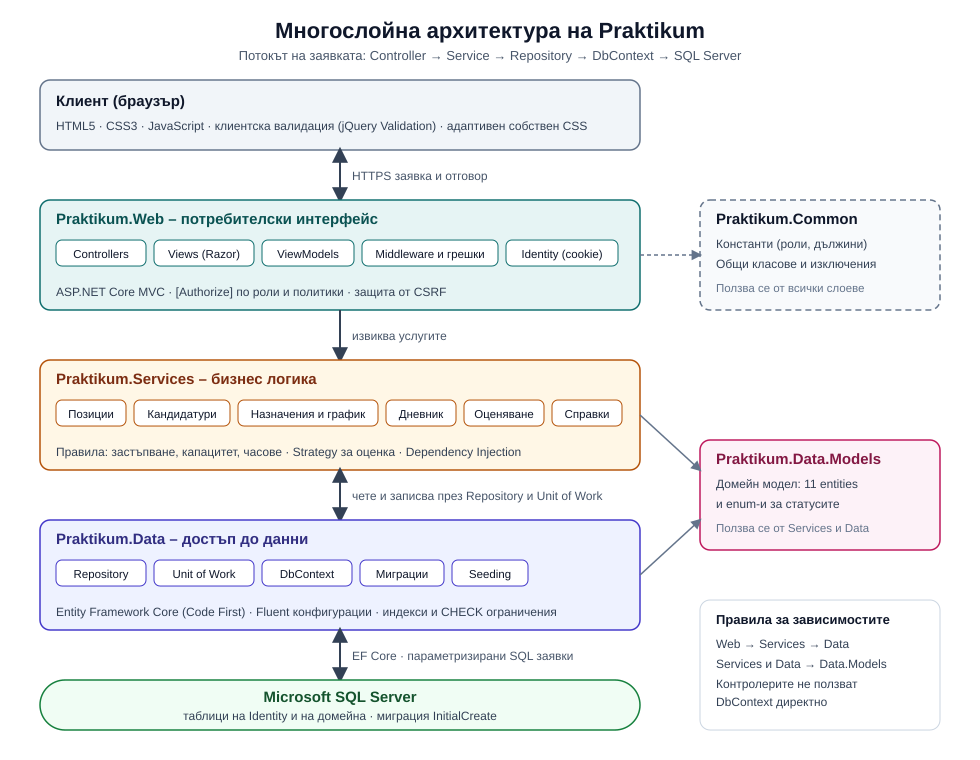

# Архитектура на приложението: диаграма на слоевете

Praktikum е изградена като многослойно приложение. Всеки слой има една отговорност и използва само слоя под себе си. Така интерфейсът, бизнес правилата и достъпът до данните се променят и тестват независимо.

*Фигура 1. Многослойна архитектура на Praktikum. Файлът с картинката е [diagrams/layers.svg](diagrams/layers.svg).*

## Слоеве и проекти

| Слой (проект) | Отговорност | Основни елементи | Какво не прави |
|---------------|-------------|------------------|----------------|
| Клиент (браузър) | Показва страниците и валидира въведеното преди изпращане | HTML5, CSS3, JavaScript, jQuery Validation | Не съдържа бизнес правила; всичко се проверява и на сървъра |
| `Praktikum.Web` | Приема заявките, проверява правата, подготвя данните за изгледите | Controllers, Views (Razor), ViewModels, Middleware, страници за грешки, ASP.NET Core Identity | Не достъпва `DbContext` директно и не съдържа бизнес правила |
| `Praktikum.Services` | Бизнес логика и правила (застъпване, капацитет, изчисляване на часове, оценка) | Услуги за позиции, кандидатури, назначения и график, дневник, оценяване, справки; Strategy за оценка; `Result` за очакваните неуспехи | Не знае за HTTP и за изгледите |
| `Praktikum.Data` | Достъп до данните и съхранение | Repository, Unit of Work, `DbContext`, Fluent конфигурации, миграции, seeding | Не съдържа бизнес правила |
| `Praktikum.Data.Models` | Домейн модел | 11 entities и enum-и за статусите | Не зависи от други проекти (освен общите константи) |
| `Praktikum.Common` | Общи константи | Имена на роли, ограничения за дължини | – |
| Microsoft SQL Server | Съхранява данните | Таблици на Identity и на домейна, уникални индекси и CHECK ограничения | – |

## Правила за зависимостите

- Посоката е `Web → Services → Data → Data.Models`; `Common` се ползва от всички слоеве.
- `Praktikum.Web` реферира и `Praktikum.Data`, но само за да регистрира `DbContext` и началното попълване на базата при стартиране.
- Връзките между слоевете са през интерфейси (например `IUnitOfWork`, `IApplicationService`), които се подават чрез Dependency Injection.
- Правилата са двойно защитени: в услугите (ясно съобщение за потребителя) и в базата (уникални индекси и CHECK ограничения като последна преграда).

## Пример за поток: одобряване на кандидатура

Примерът показва как заявка минава през слоевете (одобряването се реализира в Етап 3; в Етап 2 са готови основата и прегледът на позициите).

1. **Браузър:** координаторът натиска „Одобри“ и изпраща форма с антифалшификационен токен.
2. **Controller:** проверява ролята (`[Authorize]`) и извиква `IApplicationService.ApproveAsync`.
3. **Service:** зарежда кандидатурата, проверява капацитета на позицията и дали ученикът няма пресичащ се период, сменя статуса и добавя известие.
4. **Unit of Work и Repository:** записват и двете промени с един `SaveChangesAsync()`, така че или успяват и двете, или никоя.
5. **DbContext и SQL Server:** EF Core изпраща параметризирани заявки; базата отказва записа при нарушено ограничение.
6. **Обратно към Controller:** при нарушено правило услугата връща неуспешен `Result` със съобщение на български (без изключения, защото нарушеното правило е очакван случай), а контролерът го показва; иначе пренасочва към списъка.

## Защо многослойна архитектура

- **Тестваемост:** бизнес логиката се тества без уеб сървър и без SQL Server, защото зависи от интерфейси.
- **Промяна на едно място:** нова скала за оценка или нов вид справка не засяга интерфейса и базата.
- **Сигурност:** проверките за права и собственост на данните са в слоя, през който минават всички заявки.
- **Яснота за екипа и за защитата:** всяка част има точно определена задача и може да се обясни самостоятелно.

Подробности: [шаблони за проектиране](design-patterns.md), [модел на данните](er-diagram.md), [концепция](koncepciya.md).

## Как да се ползва картинката в документацията

Файлът `diagrams/layers.svg` е векторен и не губи качество при увеличение. В Word може да се вмъкне през **Вмъкване → Картини**, а за PDF или презентация може да се експортира като PNG от браузър.
