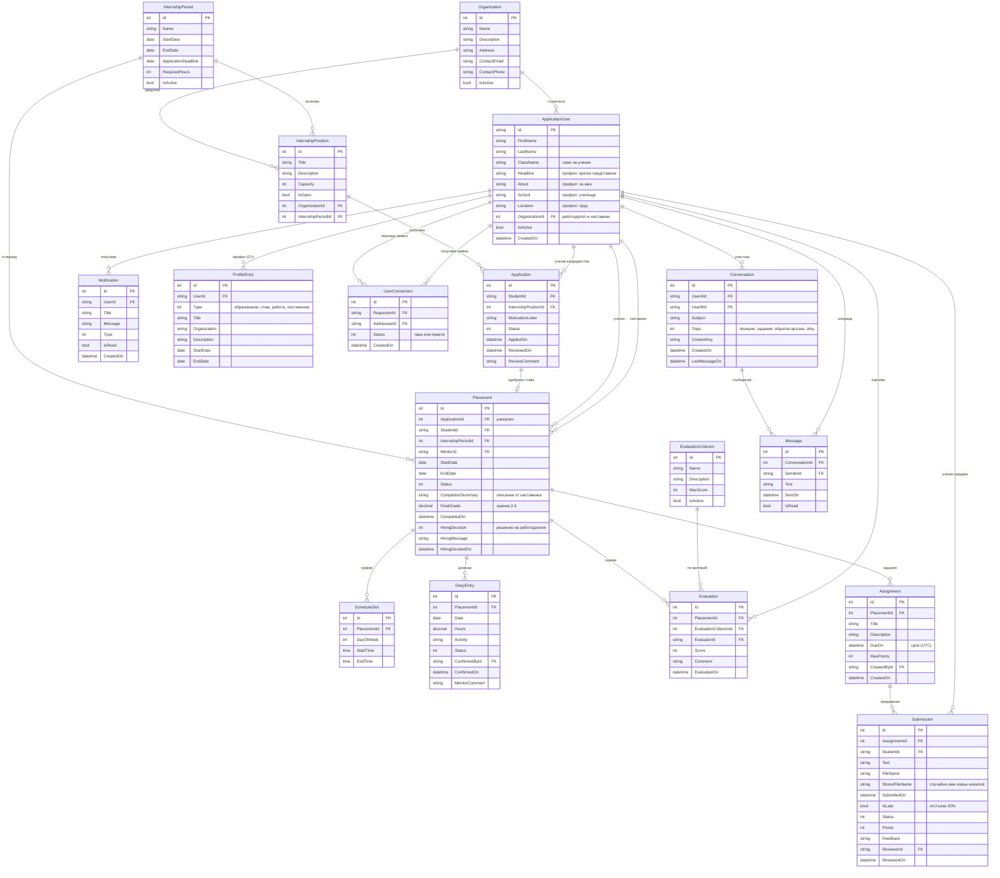

# ER диаграма – Praktikum

## Основни правила и ограничения

| Правило | Къде се пази |
|---------|--------------|
| Ученик кандидатства веднъж за позиция | Уникален индекс `(StudentId, InternshipPositionId)` |
| От една кандидатура става най-много едно назначаване | Уникален индекс `Placement.ApplicationId` |
| Ученик има едно активно назначаване на период | Филтриран уникален индекс `(StudentId, InternshipPeriodId)` при `Status <> Cancelled` |
| `StartDate <= EndDate` | CHECK ограничение в базата |
| Припокриващи се назначавания и графици | Бизнес логика в `Services` (SQL не може лесно да сравнява интервали) |
| Една оценка на критерий за назначаване | Уникален индекс `(PlacementId, EvaluationCriterionId)` |
| Часовете в дневника са между 0 и 12 | CHECK ограничение + валидация в услугата |
| Една заявка за връзка между двама потребители | Уникален индекс `(RequesterId, AddresseeId)` + CHECK, че не са един и същ човек |
| Едно предаване на ученик за задание | Уникален индекс `(AssignmentId, StudentId)` |
| Крайната оценка е между 2 и 6 | `FinalGrade` с точност (3,2) + валидация в услугата |
| Закъснели предавания губят 20% | Бизнес логика (`LatePolicy`, множител 0.8) |
| Файловете не са достъпни по адрес | Пазят се в `App_Data/uploads` със случайно име; изтеглянето минава през контролер с проверка на достъпа |

## Решения, които да можеш да обясниш

- **Placement има и `StudentId`, и `InternshipPeriodId`**, въпреки че ги има през кандидатурата и позицията. Дублирането е нарочно: така базата може да наложи уникалност с индекс.
- **Един `ApplicationUser` за всички роли.** Ролите са на Identity, а `OrganizationId` е празно за ученици и координатори.
- **Изтриването е ограничено (Restrict)**, за да не изчезват оценки и дневник заради изтрита организация.
