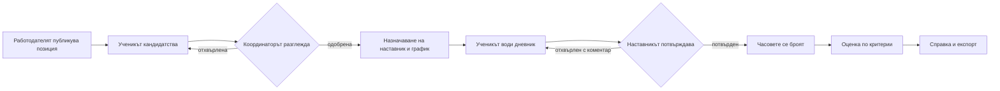
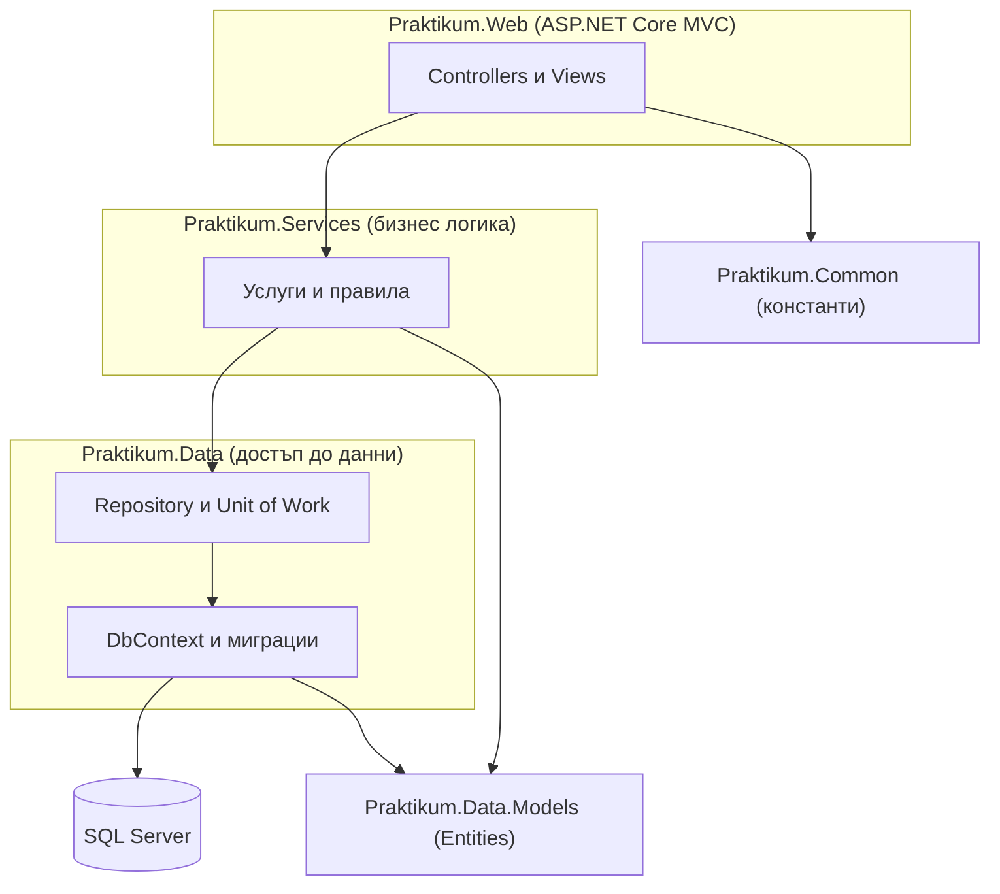

# Концепция на системата Praktikum

## 1. Идея

**Praktikum** е уеб система, в която училището, организациите и учениците водят цялото практическо обучение на едно място: от обявяването на позиция и кандидатстването до записването на часовете, потвърждаването им от наставника и оценяването.

## 2. Проблем и решение

| Проблем | Как го решава концепцията |
|---------|---------------------------|
| Позиции, кандидатури и разпределение са в различни имейли и таблици | Единна база с позиции, кандидатури и назначения, видими според ролята |
| Ученик може да бъде записан в два пресичащи се периода или графика | Проверка за застъпване в бизнес логиката и ограничения в базата данни |
| Часовете се потвърждават и сумират на ръка | Дневник със статуси „чака“, „потвърден“, „отхвърлен“; броят се само потвърдените часове |
| Справките отнемат време | Справка по период, организация, клас и статус с експорт за Excel |
| Срокове се пропускат | Известия за изтичащи срокове и непотвърдени записи |
| Оценяването е неравномерно | Общи критерии с точки и оценка по скала 2–6 |

## 3. Потребители и роли

| Роля | Цели | Основни действия |
|------|------|------------------|
| Администратор | Поддържа системата в ред | Управлява потребители, роли, периоди и настройки |
| Координатор (учител) | Организира практиката и следи резултатите | Управлява периоди, организации и критерии; одобрява кандидатури; назначава наставник и график; прави справки |
| Работодател | Намира стажанти | Поддържа профила на организацията и публикува позиции |
| Наставник | Ръководи и оценява стажантите | Потвърждава записите в дневника, оценява по критерии |
| Ученик | Намира практика и я отчита | Разглежда позиции, кандидатства, води дневник, вижда график, оценки и известия |

Ученикът се регистрира сам. Останалите роли се създават от администратор, за да не може всеки да си даде права на наставник или координатор.

## 4. Основен процес

Правила по процеса:

- кандидатстването е възможно само за отворена позиция, в активен период и до крайния срок;
- одобрението не надхвърля капацитета на позицията и не допуска пресичащи се периоди за един ученик;
- записи в дневника се добавят само за дни от срока на практиката, до днес и най-много 12 часа на ден;
- отхвърлен запис се коригира и се подава отново; потвърден запис не се променя;
- оценката е предварителна, докато не са оценени всички активни критерии.

## 5. Функционални изисквания

Приоритетите са: **М** – задължително по заданието, **С** – желателно.

| № | Изискване | Роля | Приоритет |
|---|-----------|------|:---------:|
| Ф1 | Регистрация, вход и изход; профил | всички | М |
| Ф2 | Достъп до функциите според ролята; отказан достъп води до страница 403 | всички | М |
| Ф3 | Управление на периоди, организации и критерии за оценяване | координатор, администратор | М |
| Ф4 | Профил на организацията и публикуване на позиции | работодател | М |
| Ф5 | Разглеждане на позиции и кандидатстване; оттегляне на кандидатура | ученик | М |
| Ф6 | Одобряване и отхвърляне на кандидатури (с причина при отхвърляне) | координатор | М |
| Ф7 | Назначаване на наставник и седмичен график | координатор | М |
| Ф8 | Защита от застъпващи се назначения и графици | система | М |
| Ф9 | Дневник на дейностите; изчисляване на присъствените часове | ученик | М |
| Ф10 | Потвърждаване или отхвърляне на записи в дневника | наставник | М |
| Ф11 | Оценяване по критерии и изчисляване на оценка | наставник | М |
| Ф12 | Справки с филтри (период, организация, клас, статус) | координатор, администратор | М |
| Ф13 | Известия за срокове и непотвърдени записи | всички | М |
| Ф14 | Експорт на справката за Excel | координатор | С |
| Ф15 | Управление на потребители и роли | администратор | М |
| Ф16 | Професионален профил (CV): образование, стажове, работа, постижения; мрежа от връзки | всички | С |
| Ф17 | Задания със срок и описание; предаване на текст или файл; преглед с точки; при закъснение оценката е с 20% по-ниска | наставник, ученик | С |
| Ф18 | Чат между два акаунта (попитване за позиция, коментар по задание, обратна връзка след стажа) | всички | С |
| Ф19 | Приключване на стажа с оценка и описание; решение на работодателя дали да предложи работа | наставник, работодател | С |

## 6. Нефункционални изисквания

| Област | Изискване |
|--------|-----------|
| Сигурност | Парола само като хеш; бисквитка с `HttpOnly`, `Secure`, `SameSite`; защита от CSRF, SQL Injection и XSS; заключване на профил след неуспешни опити |
| Конфигурация | В хранилището няма пароли и connection strings (User Secrets за разработка, променливи на средата за продукция) |
| Достъпност и дизайн | Адаптивен интерфейс за телефон, таблет и компютър със собствен CSS; контрастни цветове, видим фокус, етикети на полетата |
| Език | Интерфейс, валидации и съобщения за грешки на български |
| Надеждност | Персонализирани страници за грешки (400, 403, 404, 500); данните не се губят при невалидно въвеждане |
| Тестваемост | Бизнес логиката е отделена от интерфейса и достъпа до данни; покритие най-малко 65% |
| Поддръжка | Многослойна архитектура, миграции на базата, автоматично изграждане и тестване при всяка промяна |
| Демонстрация | Начални данни и демо акаунт за всяка роля; всички данни са измислени |

## 7. Архитектурна концепция

- Потокът е `Controller → Service → Repository → DbContext`, а зависимостите се подават чрез Dependency Injection.
- **Repository и Unit of Work** изолират бизнес логиката от Entity Framework Core и записват свързани промени заедно.
- **Strategy** позволява скалата за оценка да се сменя, без да се променя услугата за оценяване.
- Подробна диаграма на слоевете с пример за поток има в [arhitektura.md](arhitektura.md).
- Обосновката на шаблоните е в [design-patterns.md](design-patterns.md), а моделът на данните – в [er-diagram.md](er-diagram.md).
- Случаите на употреба по роли са в [use-case-diagram.md](use-case-diagram.md), а скиците на екраните – в [wireframes.md](wireframes.md).

## 8. Цел и критерии за успех

Целта на проекта е формулирана в [увода](uvod.md). За да може да се провери дали е постигната, се определят измерими критерии:

| Критерий | Как се проверява |
|----------|------------------|
| Основният процес минава от край до край без ръчна намеса в базата | Интеграционен тест и демонстрация с демо акаунтите |
| Пет роли с различни права | Тестове за достъп по роли |
| Застъпване на периоди и графици не е възможно | Unit и интеграционни тестове |
| Покритие на бизнес логиката най-малко 65% | Отчет от CI |
| Няма SQL Injection и XSS при тестваните полета | Интеграционни тестове с вредни стойности |
| Публичен адрес с демо данни | Работещо демо, в което всяка роля влиза с демо акаунт |
| Документацията обхваща всички етапи | План по етапи в [README.md](README.md) |

## 9. Рискове

| Риск | Мярка |
|------|-------|
| Обхватът е голям за срока | Работа на етапи; първо основният процес, после справки и известия |
| Грешки в правилата за застъпване | Покриване с тестове с гранични случаи |
| Изтичане на данни от хранилището | Никакви пароли и ключове в кода; проверка преди публикуване |
| Зависимост от безплатен хостинг със SQL Server | Избор на хостинг в Етап 3; приложението се стартира и локално с Docker |
| Различно поведение между тестова и реална база | Допълнителна проверка на миграциите върху SQL Server в CI |

## 10. Етапи

| Етап | Срок | Основни резултати |
|------|------|-------------------|
| 1 | 16.11.2026 | Концепция, проучване, увод, структура на приложението, начална версия на базата, хранилище в GitHub |
| 2 | 18.12.2026 | Работеща основа на клиентската и сървърната част (вход, роли, начални данни, преглед на позиции, страници за грешки), втора глава, use case диаграма и wireframes |
| 3 | 12.02.2027 | Основни функционалности, трета глава, валидации, роли и права |
| 4 | 26.03.2027 | Завършен проект, тестове, документация, заключение, ръководство за потребителя |
| Предаване | 19.04.2027 | Краен срок за предаване |
| Защита | 21.05.2027 | Защита на дипломния проект |
