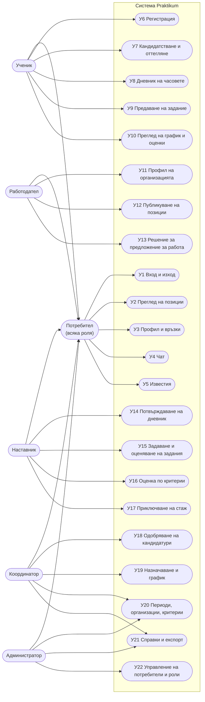

# Use case диаграма по роли

Диаграмата показва какво прави всяка роля в Praktikum. Всеки случай на употреба има номер, с който се свързва с функционалните изисквания от [концепцията](koncepciya.md).

*Фигура 2. Use case диаграма. Стрелката от ролята към „Потребител“ означава, че ролята наследява общите възможности (вход, преглед на позиции, профил, чат, известия).*

## Описание на случаите на употреба

| № | Случай на употреба | Роля | Резултат | Изискване | Етап |
|---|--------------------|------|----------|:---------:|:----:|
| У1 | Вход и изход | всички | Влиза се с имейл и парола; сесията е защитена | Ф1, Ф2 | 2 |
| У2 | Преглед на позиции | всички | Списък с търсене и филтър по период; детайли на позиция | Ф5 | 2 |
| У3 | Профил и връзки | всички | CV (образование, стажове, работа, постижения) и мрежа от връзки | Ф16 | 3 |
| У4 | Чат | всички | Разговор между два акаунта по позиция, задание или стаж | Ф18 | 3 |
| У5 | Известия | всички | Известия за решения, задания, оценки и заявки | Ф13 | 3 |
| У6 | Регистрация | ученик | Нов профил на ученик; другите роли се създават от администратор | Ф1 | 2 |
| У7 | Кандидатстване и оттегляне | ученик | Кандидатура с мотивационно писмо за отворена позиция до крайния срок | Ф5 | 3 |
| У8 | Дневник на часовете | ученик | Записи със статус „чака“, „потвърден“, „отхвърлен“ | Ф9 | 3 |
| У9 | Предаване на задание | ученик | Текст или файл до срока; след срока оценката е с 20% по-ниска | Ф17 | 3 |
| У10 | Преглед на график и оценки | ученик | Седмичен график, оценки по критерии и по задания | Ф7, Ф11 | 3 |
| У11 | Профил на организацията | работодател | Данни за контакт и описание | Ф4 | 3 |
| У12 | Публикуване на позиции | работодател | Създаване, редакция, затваряне на позиции | Ф4 | 3 |
| У13 | Решение за предложение за работа | работодател | След приключен стаж: предложение или отказ със съобщение | Ф19 | 3 |
| У14 | Потвърждаване на дневник | наставник | Потвърждава или отхвърля запис с коментар | Ф10 | 3 |
| У15 | Задаване и оценяване на задания | наставник | Задание със срок; точки и обратна връзка | Ф17 | 3 |
| У16 | Оценка по критерии | наставник | Точки по критерии и оценка по скала 2–6 | Ф11 | 3 |
| У17 | Приключване на стаж | наставник | Окончателна оценка и описание, които стигат до работодателя | Ф19 | 3 |
| У18 | Одобряване на кандидатури | координатор | Одобрение (с проверка на капацитет и застъпване) или отхвърляне с причина | Ф6, Ф8 | 3 |
| У19 | Назначаване и график | координатор | Наставник и седмичен график без застъпване | Ф7, Ф8 | 3 |
| У20 | Периоди, организации, критерии | координатор, администратор | Справочници за процеса | Ф3 | 3 |
| У21 | Справки и експорт | координатор, администратор | Справка с филтри и експорт за Excel | Ф12, Ф14 | 4 |
| У22 | Управление на потребители и роли | администратор | Създаване на наставници, работодатели и координатори | Ф15 | 3 |

## Основен сценарий (ученик)

1. Ученикът се **регистрира** (У6) и **влиза** (У1).
2. **Разглежда позициите** (У2) и **кандидатства** (У7).
3. Координаторът **одобрява** кандидатурата (У18) и **назначава** наставник и график (У19).
4. Ученикът **води дневник** (У8) и **предава задания** (У9); наставникът **потвърждава** (У14) и **оценява** (У15, У16).
5. Наставникът **приключва стажа** (У17), а работодателят **решава** дали да предложи работа (У13).

## Права на достъп

Всеки случай на употреба е защитен на сървъра с `[Authorize]` по роля. Достъпът без вход води до страницата за вход, а недостатъчните права – до страница 403. Подробната матрица „роля → действие“ е част от Етап 3.
