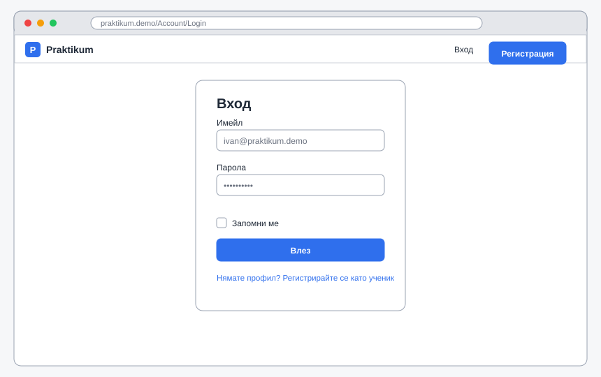
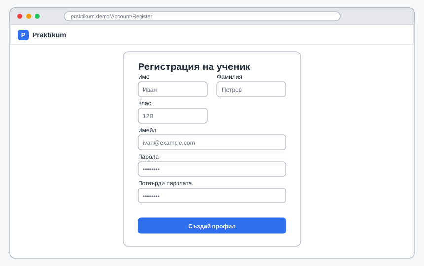
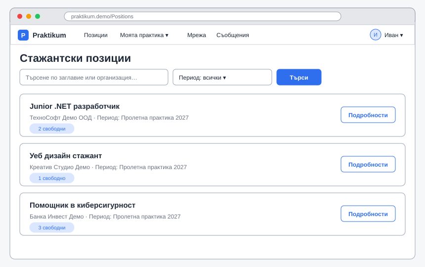
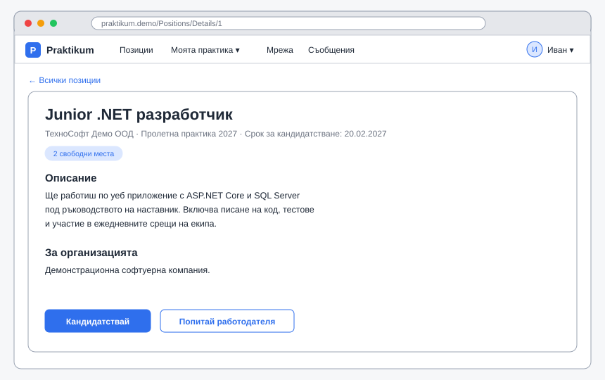
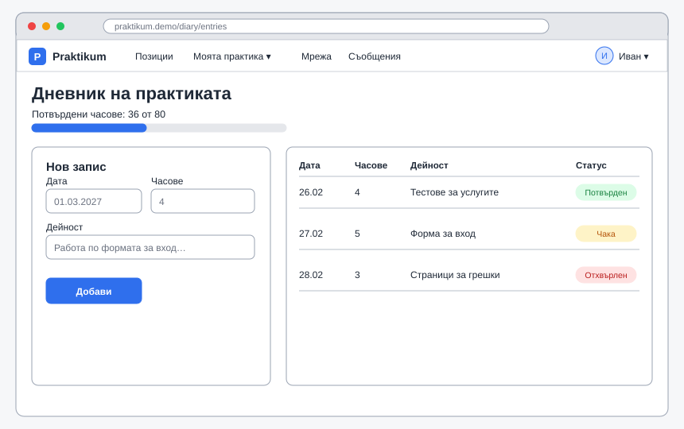
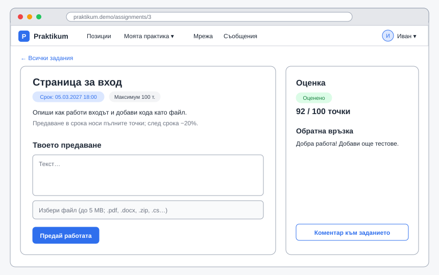
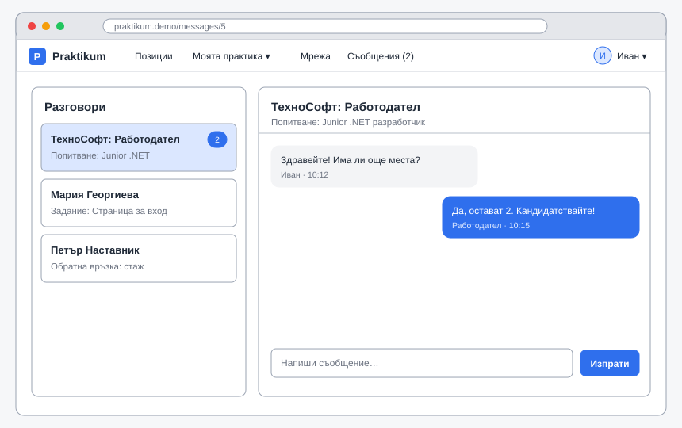
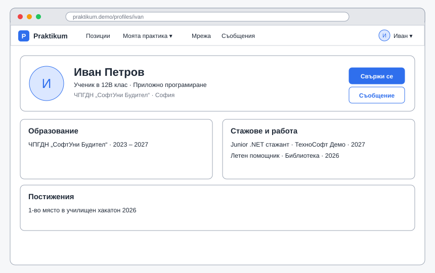

# Wireframes на основните екрани

Wireframes са схематични скици на екраните преди (и по време на) реализацията. Показват подредбата на елементите, а не крайния дизайн. Всички файлове са векторни (SVG) и се намират в [diagrams/](diagrams/).

## Общи принципи

- **Навигация:** най-важните страници са директно в горното меню (Позиции, Мрежа, Съобщения); останалите са в падащи менюта според ролята. Менюто на телефон се свива до бутон.
- **Адаптивност:** страниците се подреждат на една колона на малки екрани; бутоните и полетата са достатъчно големи за допир.
- **Достъпност:** видим фокус, етикети на всички полета, контрастни цветове, връзка „Към съдържанието“ за клавиатура.
- **Обратна връзка:** съобщения за успех (зелено) и грешка (червено) над съдържанието; грешките при въвеждане са до полето.
- **Състояния:** статусите (чака, потвърден, отхвърлен, оценено) се показват с цвят **и** с текст, не само с цвят.

## Екрани на Етап 2 (основата)

### 1. Вход

*Фигура 3. Вход. Полета: имейл и парола, „Запомни ме“. При грешка съобщението е общо („Грешен имейл или парола“), за да не се издава кои имейли съществуват.*

### 2. Регистрация на ученик

*Фигура 4. Регистрация. Само ученикът се регистрира сам; другите роли се създават от администратор.*

### 3. Списък с позиции

*Фигура 5. Позиции. Търсене по текст, филтър по период, карти със свободни места.*

### 4. Детайли на позиция

*Фигура 6. Детайли. Описание, организация и действия: „Кандидатствай“ (ученик) и „Попитай работодателя“ (чат).*

## Екрани за следващите етапи

### 5. Дневник на ученика

*Фигура 7. Дневник. Нов запис, лента с потвърдените часове и таблица със статуси.*

### 6. Задание

*Фигура 8. Задание (изглед на ученик). Срок, предаване на текст или файл, оценка и обратна връзка.*

### 7. Чат

*Фигура 9. Чат. Списък с разговори по теми и поток от съобщения.*

### 8. Профил (CV)

*Фигура 10. Профил. Образование, стажове и работа, постижения; бутони „Свържи се“ и „Съобщение“.*

## Връзка със случаите на употреба

| Екран | Случай на употреба |
|-------|--------------------|
| Вход | У1 |
| Регистрация | У6 |
| Позиции, Детайли | У2, У7 |
| Дневник | У8 |
| Задание | У9, У15 |
| Чат | У4 |
| Профил | У3 |

Вижте [use case диаграмата](use-case-diagram.md).
